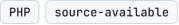
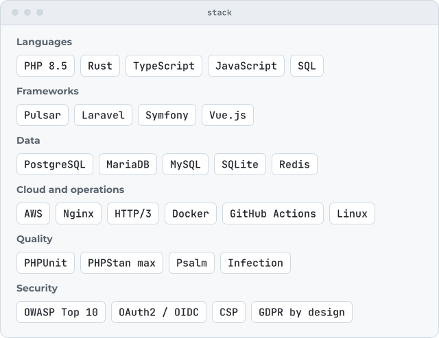
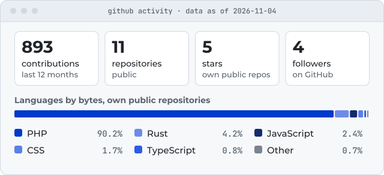
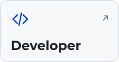
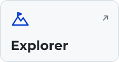

<a href="https://lennyobez.com"><picture><source media="(prefers-color-scheme: dark)" srcset="assets/header-dark.svg"><source media="(prefers-color-scheme: light)" srcset="assets/header-light.svg"></picture></a>

  <a href="https://lennyobez.com">lennyobez.com</a> ·
  <a href="https://www.linkedin.com/in/lennyobez">LinkedIn</a> ·
  <a href="mailto:github@lennyobez.com">github@lennyobez.com</a>

## About

I am Lenny Obez, a senior full-stack developer, photographer and explorer based in Huy, Belgium, with 11+ years building for the web. I wrote and maintain Pulsar Framework, a PHP 8.5 framework for security-critical applications, and I reach for Rust where a guarantee matters more than a deadline. I run production on AWS and have moved several employers off shared hosting onto it.

From late 2023 to early 2025 I built the Belgian federal and municipal election platforms (gebel.be, iwc-elections.be, iwc-procurations.be); iwc-procurations.be was adopted by 63 of the 133 municipalities concerned. Alongside my current role, I take freelance projects for clients across Belgium, Luxembourg and France.

Away from the keyboard I photograph people and places, and I explore: climbing, parkour and urban exploration.

## Featured projects

### [Pulsar Framework](https://github.com/LennyObez/pulsar-framework)

<a href="https://github.com/LennyObez/pulsar-framework"><picture><source media="(prefers-color-scheme: dark)" srcset="assets/projects/pulsar-framework-dark.svg"><source media="(prefers-color-scheme: light)" srcset="assets/projects/pulsar-framework-light.svg"></picture></a>

A modular PHP 8.5+ framework for security-critical applications: deterministic boot, explicit HMVC module boundaries, an extension system with stable hooks and a versioned lifecycle, built-in observability (structured logs, OpenMetrics, tracing) and audit logging. PHP 8.5+, Apache-2.0 licence, pre-1.0.

### [adiungere](https://github.com/LennyObez/adiungere)

<a href="https://github.com/LennyObez/adiungere"><picture><source media="(prefers-color-scheme: dark)" srcset="assets/projects/adiungere-dark.svg"><source media="(prefers-color-scheme: light)" srcset="assets/projects/adiungere-light.svg"></picture></a>

In early construction. A two-camera dashcam writes both cameras into one file, and most players only show the first. adiungere is being built to find those recordings, play either camera or both, and export each one without re-encoding while keeping the vendor telemetry, from one Rust core shared by every platform. Its command line already inspects a recording, fingerprints every track and exports either camera without re-encoding. Rust, Apache-2.0 licence.

### [Both Decks](https://github.com/LennyObez/bothdecks)

<a href="https://github.com/LennyObez/bothdecks"><picture><source media="(prefers-color-scheme: dark)" srcset="assets/projects/bothdecks-dark.svg"><source media="(prefers-color-scheme: light)" srcset="assets/projects/bothdecks-light.svg"></picture></a>

In early construction. A two-sided job-matching platform for the European Union, planned for the web, Android and iOS over one backend: candidates swipe offers, recruiters swipe profiles, and a mutual match opens a conversation. Occupations and skills are stored as codes from a multilingual taxonomy, so that search behaves the same across 24 languages. PHP, source-available licence.

### [to-spec](https://github.com/LennyObez/to-spec)

<a href="https://github.com/LennyObez/to-spec"><picture><source media="(prefers-color-scheme: dark)" srcset="assets/projects/to-spec-dark.svg"><source media="(prefers-color-scheme: light)" srcset="assets/projects/to-spec-light.svg"></picture></a>

A Claude Code plugin that keeps a coding session on rails. Before a command that would delete work runs, it copies that work behind a private reference; it holds back credentials about to be published; and at the end of each turn it says plainly what is left to do. It needs Node 20 or newer. JavaScript, Apache-2.0 licence.

Smaller repositories and the projects still in design are listed on [lennyobez.com/development/open-source](https://lennyobez.com/development/open-source).

## Tech stack

<a href="https://lennyobez.com/development/stack"><picture><source media="(prefers-color-scheme: dark)" srcset="assets/stack-dark.svg"><source media="(prefers-color-scheme: light)" srcset="assets/stack-light.svg"></picture></a>

The stack as text

- Languages: PHP 8.5, Rust, TypeScript, JavaScript, SQL
- Frameworks: Pulsar, Laravel, Symfony, Vue.js
- Data: PostgreSQL, MariaDB, MySQL, SQLite, Redis
- Cloud and operations: AWS, Nginx, HTTP/3, Docker, GitHub Actions, Linux
- Quality: PHPUnit, PHPStan max, Psalm, Infection
- Security: OWASP Top 10, OAuth2 / OIDC, CSP, GDPR by design

## GitHub activity

<a href="https://github.com/LennyObez/LennyObez/blob/main/assets/stats.json"><picture><source media="(prefers-color-scheme: dark)" srcset="assets/stats-dark.svg"><source media="(prefers-color-scheme: light)" srcset="assets/stats-light.svg"></picture></a>

<!-- stats:start -->
894 contributions in the last 12 months, 11 public repositories, 5 stars, 4 followers. Languages by bytes across own public repositories: PHP 86.2%, Rust 3.6%, CSS 3.2%, PLpgSQL 3.1%, JavaScript 2.6%, Other 1.3%. Data as of 2026-11-04.
<!-- stats:end -->

Refreshed weekly from the GitHub API by [a scheduled workflow](https://github.com/LennyObez/LennyObez/blob/main/.github/workflows/stats.yml). Repository and follower counts are GitHub's own; stars are summed over public repositories other than forks. Language shares leave out forks, archived repositories and this profile repository, and count as PHP the PHP files that GitHub's classifier labels as Hack when the repository holds no Hack file.

## Three disciplines

<a href="https://lennyobez.com/development"><picture><source media="(prefers-color-scheme: dark)" srcset="assets/disciplines/developer-dark.svg"><source media="(prefers-color-scheme: light)" srcset="assets/disciplines/developer-light.svg"></picture></a>
<a href="https://lennyobez.com/photography"><picture><source media="(prefers-color-scheme: dark)" srcset="assets/disciplines/photographer-dark.svg"><source media="(prefers-color-scheme: light)" srcset="assets/disciplines/photographer-light.svg"></picture></a>
<a href="https://lennyobez.com/explore"><picture><source media="(prefers-color-scheme: dark)" srcset="assets/disciplines/explorer-dark.svg"><source media="(prefers-color-scheme: light)" srcset="assets/disciplines/explorer-light.svg"></picture></a>

Client platforms and Pulsar; portrait, corporate and reportage photography; climbing, parkour and urban exploration. Each has its own section on lennyobez.com.

## Contact

Open to freelance projects.

- Project: [lennyobez.com/contact](https://lennyobez.com/contact)
- Email: [github@lennyobez.com](mailto:github@lennyobez.com)
- LinkedIn: [linkedin.com/in/lennyobez](https://www.linkedin.com/in/lennyobez)
